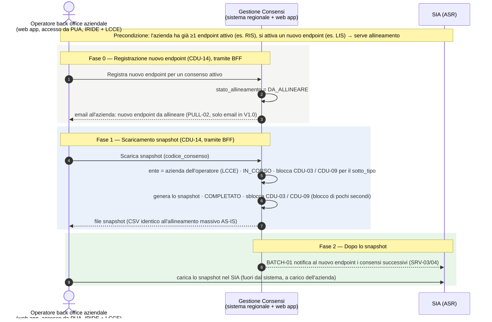
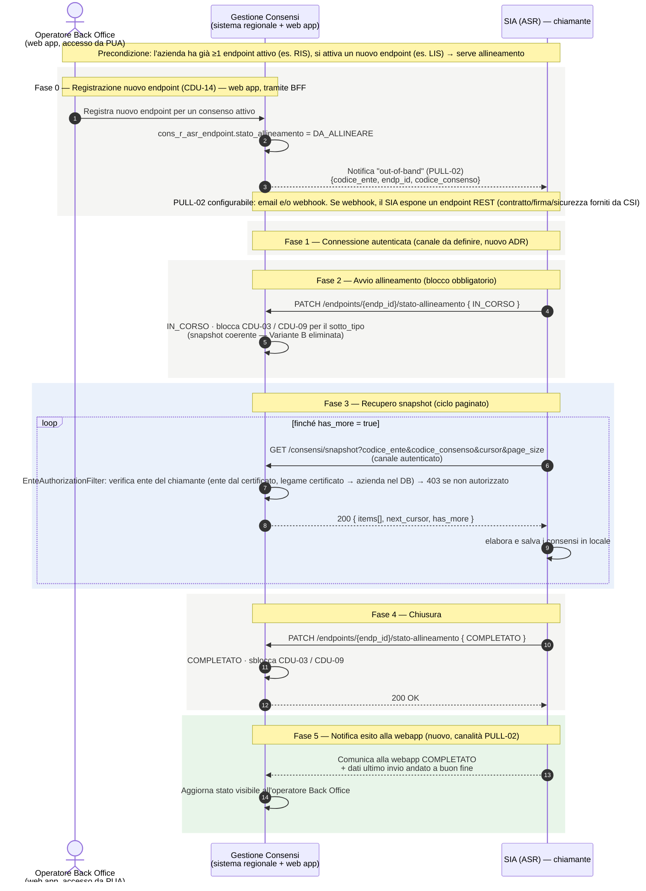

---
{"dg-publish":true,"permalink":"/cdu-17-diagramma-sequenza/","dg-note-properties":{}}
---

# CDU-17 — Diagramma di sequenza (allineamento consensi in modalità PULL)

**Scopo:** descrivere il funzionamento del **CDU-17**, il caso d'uso che sostituisce **BATCH-03**. Quando un operatore di **Back Office** registra un nuovo endpoint per un'azienda che ha **già almeno un altro endpoint attivo** (es. RIS attivo, si attiva un LIS → serve allineamento dei consensi), non è più il sistema regionale a "spingere" (push) i consensi: è **l'azienda** che li **scarica** (pull) dal sistema regionale ("centro stella"). In **V1.0** lo scaricamento lo fa l'**operatore di back office aziendale** dalla web app; lo scaricamento automatico dal **SIA** è lo scenario futuro, descritto più sotto.

> **Aggiornamento call CSI 20/07/2026 (rifacimento CDU-17):**
> - Attore = **operatore con profilo Back Office** sulla **web app Gestione Consensi** (accesso da **PUA**).
> - **Variante B (watermark/no-blocco) ELIMINATA**: il blocco temporaneo delle acquisizioni è **obbligatorio** (unica modalità) per garantire uno snapshot coerente.
> - 🆕 **Proposta A+D (06/11/2026, da confermare con CSI, ST-11):** in V1.0 fa tutto l'operatore di back office aziendale dalla web app (BFF, JWT interno). I servizi REST per il SIA restano nel codice ma **non sono esposti** ([[wiki/docs/adr/ADR-027-architettura-senza-api-manager\|ADR-027]]). Il centro stella resta: il dato esce solo dal sistema regionale e l'azienda va a prenderselo. ~~Il SIA chiama in mutual TLS, come per `ConsprefService` (decisione dedotta).~~ Superato: `ConsprefService` usa la firma WS-Security, non il mutual TLS.
> - **Nuovo passo 5**: a chiusura, il SIA **comunica alla webapp lo stato COMPLETATO e i dati dell'ultimo invio andato a buon fine**, tramite la **stessa canalità di PULL-02**.
> - **Canale notifica PULL-02 (deciso 20/07/2026):** si mantengono **entrambe** le modalità — **email e/o webhook** — selezionabili via **parametro di configurazione** (solo email / solo webhook / entrambi). Con il **webhook** il SIA deve **esporre un servizio REST**, il cui **contratto, firma e sicurezza sono forniti da CSI**. 🆕 In V1.0 solo email (06/11/2026): il webhook richiede sviluppo da parte delle ASR.
> - I servizi di inserimento, modifica ed eliminazione endpoint si usano **solo dalla web app** (CDU-14). Alle aziende sono esposti solo il cambio di stato di allineamento e la manutenzione.
> - Scenario di **manutenzione endpoint** (senza inserimento di nuovo endpoint) trattato a parte: [[Manutenzione-endpoint_diagramma-sequenza\|Manutenzione endpoint — Diagramma di sequenza]].

> Nota: CDU-17 è una **proposta tecnica** (rif. TR34/TR68, ADR-006); il rifacimento 20/07/2026 recepisce le indicazioni del committente.

---

## V1.0 — Diagramma (solo operatore, proposta A+D)

### I passi V1.0, in parole semplici

0. **Registrazione.** Un operatore di back office registra il nuovo endpoint da CDU-14. Il sistema lo segna **DA_ALLINEARE** e avvisa l'azienda via email (PULL-02).
1. **Scaricamento.** L'operatore di back office aziendale scarica lo snapshot da CDU-14. Il sistema prende l'ente dall'abilitazione LCCE dell'operatore, quindi solo i dati della sua azienda (da verificare che l'abilitazione LCCE sia per azienda). Il blocco delle acquisizioni dura solo il tempo di generare lo snapshot; poi l'endpoint è subito **COMPLETATO**.
2. **Dopo.** Da quel momento BATCH-01 notifica i nuovi consensi anche al nuovo endpoint. L'azienda carica lo snapshot nel suo SIA, sotto la sua responsabilità, come oggi con il CSV: il file ha lo stesso tracciato ([[wiki/sources/2019-05-01-specifica-ws-consenso-regionale-aziendale-v02c\|specifica v02c]], cap. 9), quindi per l'azienda non cambia niente. Non serve una conferma di fine allineamento nel sistema.

---

## Scenario futuro — Diagramma (SIA chiamante, non esposto in V1.0)

> ⚠️ Richiede uno sviluppo da parte delle ASR (un client per il nuovo servizio), **oggi non previsto**: le ASR non devono adeguarsi. Servirebbero anche un nuovo ADR, un canale autenticato e il legame tra credenziale e azienda. Vedi ST-11.

---

## I passi dello scenario futuro, in parole semplici

0. **Registrazione (Back Office).** Un operatore con **profilo Back Office**, sulla web app Gestione Consensi (accesso da **PUA**), aggiunge un nuovo endpoint per una ASR (CDU-14). Il sistema segna quell'endpoint come **DA_ALLINEARE** e avvisa il SIA che c'è da fare l'allineamento (notifica "fuori banda"). La notifica può essere via **email e/o webhook** (configurabile con apposito parametro); con il **webhook** il SIA espone un endpoint REST il cui **contratto è fornito da CSI**. *Questa operazione passa dal BFF della web app.*
1. **Connessione.** Il SIA si collega su un canale autenticato con il certificato dell'azienda (da definire con un nuovo ADR; richiede sviluppo da parte delle ASR, non previsto).
2. **Avvio.** Il SIA dichiara "sto iniziando" (**IN_CORSO**). Per avere una "foto" coerente, il sistema **blocca temporaneamente** i nuovi consensi di quel tipo. *(Unica modalità — la variante watermark senza blocco è stata eliminata.)*
3. **Scaricamento a pagine.** Il SIA chiama ripetutamente `GET /consensi/snapshot` passando un **cursore**; a ogni chiamata riceve una pagina di consensi + il cursore per la successiva, finché **`has_more = false`**. A ogni chiamata il sistema verifica che il SIA stia leggendo **solo i dati del proprio ente**.
4. **Chiusura.** Il SIA dichiara **COMPLETATO**; il sistema sblocca le acquisizioni e l'allineamento è concluso.
5. **Notifica esito alla webapp.** Il SIA **comunica alla webapp lo stato COMPLETATO e i dati dell'ultimo invio andato a buon fine**, tramite la **stessa canalità di PULL-02**. La webapp aggiorna lo stato visibile all'operatore.

---

## Servizi per le aziende (nel codice, non esposti in V1.0)

`PATCH /endpoints/{endp_id}/stato-allineamento` (CDU-17) e `PATCH /endpoints/{endp_id}/stato` (manutenzione: [[Manutenzione-endpoint_diagramma-sequenza\|Manutenzione endpoint]]) restano nel codice ma **non sono esposti in V1.0** (proposta A+D, ST-11). Oggi si fidano dell'header dell'API Manager per il codice ente: prima di esporli servono autenticazione e legame tra credenziale e azienda (rischio ST-14). Il CRUD degli endpoint (inserimento, modifica, eliminazione) resta solo nella web app (CDU-14).

---

## Punti d'interazione — stato dopo la call 20/07/2026

| #   | Punto                       | Esito                                                                                                     | Rif.    |
| --- | --------------------------- | --------------------------------------------------------------------------------------------------------- | ------- |
| A   | **Capacità del SIA**        | ✅ Chiamate REST attive confermate (PULL-08). 🆕 In V1.0 nessuna chiamata dal SIA: scarica l'operatore aziendale (proposta A+D, ST-11). ~~canale: mutual TLS (decisione dedotta)~~ | PULL-08 |
| B   | **Canale di notifica**      | ✅ **Deciso:** email **e/o** webhook, via parametro di configurazione (solo email / solo webhook / entrambi). Con webhook il SIA espone un endpoint REST (contratto/firma/sicurezza forniti da CSI) | PULL-02 |
| C   | **Coerenza dello snapshot** | ✅ **Blocco obbligatorio** durante il pull (Variante A). **Variante B watermark ELIMINATA**               | PULL-01 |
| D   | **Conferma completamento**  | In V1.0 COMPLETATO allo scaricamento, nessuna conferma. Nello scenario futuro: PATCH di conferma idempotente | PULL-07 |
| E   | **Dimensione pagina**       | `page_size` max e tarabilità per ASR da precisare                                                          | PULL-04 |

---

*Riferimenti wiki: [[wiki/concepts/alternativa-batch-03-pull\|Alternativa BATCH-03 — PULL CDU-17]] · [[wiki/docs/adr/ADR-027-architettura-senza-api-manager\|ADR-027]] · [[Manutenzione-endpoint_diagramma-sequenza\|Manutenzione endpoint]] · [[wiki/concepts/sicurezza-cdu-15-16\|Sicurezza CDU-15/16]] · SRS §6.17. Dettaglio punti aperti: [[wiki/analyses/analysis-2026-05-14-punti-aperti-csi\|Tracker punti aperti CSI]] §3.*
