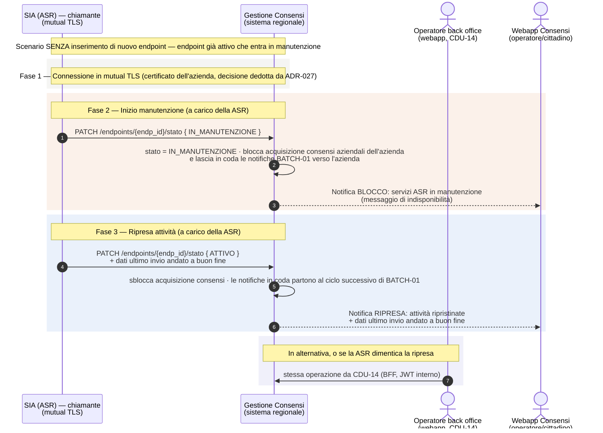

---
{"dg-publish":true,"permalink":"/manutenzione-endpoint-diagramma-sequenza/","dg-note-properties":{}}
---

# Manutenzione endpoint — Diagramma di sequenza (blocco acquisizione durante manutenzione)

**Scopo:** descrivere lo scenario — **distinto da CDU-17** — in cui **non** si inserisce un nuovo endpoint, ma un'azienda (ASR) entra in **finestra di manutenzione** di un endpoint già attivo. Durante la manutenzione il sistema deve **bloccare l'acquisizione dei consensi** verso quell'azienda e **notificare la webapp** Gestione Consensi sia dell'inizio del blocco sia della ripresa delle attività.

> **Origine:** call CSI 20/07/2026 (rifacimento CDU-17) — "MANCA SCENARIO DI MANUTENZIONE END-POINT". Si lega alla decisione dell'11/06/2026 recepita in **SRS §7.4 (Gestione manutenzione ASR — start/stop servizi)**.

> 🆕 **Senza API Manager ([[wiki/docs/adr/ADR-027-architettura-senza-api-manager\|ADR-027]], 05/11/2026). Decisione dedotta (BE-25):**
> - il SIA dichiara inizio e fine manutenzione in **mutual TLS**, sullo stesso canale di CDU-17;
> - l'operatore di back office ha la stessa operazione da **CDU-14**, utile anche per togliere una manutenzione dimenticata (BE-25b).
>
> Stato di ripresa `ATTIVO` (SRS rev. 1.29). La versione precedente, con autenticazione tramite API Manager, è in `backup/`.

---

## Diagramma

---

## I passi, in parole semplici

1. **Connessione.** Il SIA chiama il sistema regionale in **mutual TLS**, con il certificato dell'azienda, come per `ConsprefService` (decisione dedotta da ADR-027).
2. **Inizio manutenzione.** Il SIA (a carico della ASR) dichiara l'endpoint **IN_MANUTENZIONE**. Il sistema:
   - **blocca l'acquisizione dei consensi aziendali** di quell'azienda, su tutti i canali;
   - **lascia in coda le notifiche** BATCH-01 verso quei sistemi;
   - **notifica la webapp** Consensi del blocco (messaggio di indisponibilità per i servizi dell'ASR).
3. **Ripresa.** Il SIA dichiara la fine manutenzione (**ATTIVO**) comunicando i **dati dell'ultimo invio andato a buon fine**. Il sistema sblocca l'acquisizione, invia le notifiche rimaste in coda e **notifica la webapp** della ripresa.
4. **Operatore.** Le stesse operazioni sono disponibili all'operatore di back office da CDU-14. Servono anche a togliere una manutenzione che l'azienda ha dimenticato (BE-25b).

---

## Note e punti da confermare

- **Stato IN_MANUTENZIONE:** colonna `stato_endpoint` su `cons_t_endpoint`, con valori `ATTIVO` e `IN_MANUTENZIONE` (SRS rev. 1.29, sviluppato su DEV il 02/11/2026).
- **Notifiche verso il SIA:** seguono la canalità **PULL-02 (deciso 20/07/2026)**, cioè email e/o webhook configurabili. Le notifiche di **blocco/ripresa verso la webapp** Consensi sono interne all'applicativo.
- **Servizi start/stop:** esposti alle aziende in mutual TLS insieme a CDU-17 (decisione dedotta da ADR-027). Certificati da concordare con CSI (ST-11).
- **Operatore:** le operazioni dalla **web app** (CDU-14) passano dal BFF con JWT interno.

---

*Riferimenti wiki: [[CDU-17_diagramma-sequenza\|CDU-17 — Allineamento PULL]] · [[wiki/concepts/batch-processes\|Processi Batch]] · [[wiki/concepts/sistemi-esterni-integrati\|Sistemi Esterni Integrati]] · [[wiki/docs/adr/ADR-027-architettura-senza-api-manager\|ADR-027]] · SRS §7.4. Punto aperto correlato: [[wiki/analyses/analysis-2026-05-14-punti-aperti-csi\|Tracker punti aperti CSI]] (BE-25, BE-25b).*
