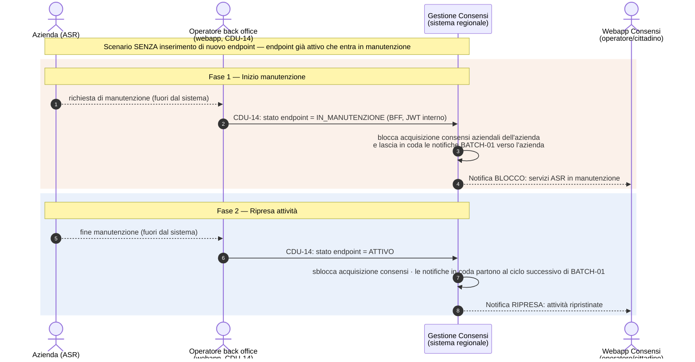
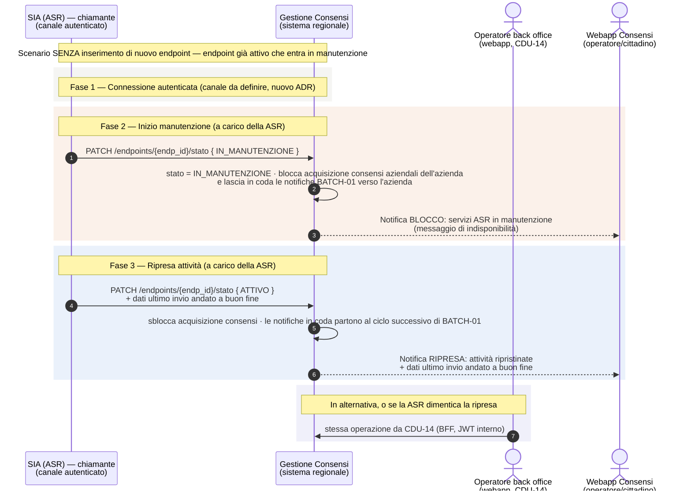

---
{"dg-publish":true,"permalink":"/manutenzione-endpoint-diagramma-sequenza/","dg-note-properties":{}}
---

# Manutenzione endpoint — Diagramma di sequenza (blocco acquisizione durante manutenzione)

**Scopo:** descrivere lo scenario — **distinto da CDU-17** — in cui **non** si inserisce un nuovo endpoint, ma un'azienda (ASR) entra in **finestra di manutenzione** di un endpoint già attivo. Durante la manutenzione il sistema deve **bloccare l'acquisizione dei consensi** verso quell'azienda e **notificare la webapp** Gestione Consensi sia dell'inizio del blocco sia della ripresa delle attività. In **V1.0** la manutenzione la imposta e la toglie l'**operatore di back office** da CDU-14, su richiesta dell'azienda; la dichiarazione automatica dal **SIA** è lo scenario futuro, descritto più sotto.

> **Origine:** call CSI 20/07/2026 (rifacimento CDU-17) — "MANCA SCENARIO DI MANUTENZIONE END-POINT". Si lega alla decisione dell'11/06/2026 recepita in **SRS §7.4 (Gestione manutenzione ASR — start/stop servizi)**.

> 🆕 **Proposta A+D (06/11/2026, da confermare con CSI, ST-11; [[wiki/docs/adr/ADR-027-architettura-senza-api-manager\|ADR-027]], BE-25):**
> - in V1.0 inizio e fine manutenzione li imposta **solo l'operatore** di back office da **CDU-14** (BFF, JWT interno), su richiesta dell'azienda. Serve anche a togliere una manutenzione dimenticata (BE-25b);
> - il servizio REST per il SIA resta nel codice ma **non è esposto** in V1.0;
> - ~~il SIA dichiara inizio e fine manutenzione in mutual TLS, sullo stesso canale di CDU-17 (decisione dedotta).~~ Superato: `ConsprefService` usa la firma WS-Security, non il mutual TLS.
>
> Stato di ripresa `ATTIVO` (SRS rev. 1.29). La versione precedente, con autenticazione tramite API Manager, è in `backup/`.

---

## V1.0 — Diagramma (solo operatore, proposta A+D)

### I passi V1.0, in parole semplici

1. **Inizio.** L'azienda chiede la manutenzione, fuori dal sistema. L'operatore di back office mette l'endpoint **IN_MANUTENZIONE** da CDU-14. Il sistema blocca l'acquisizione dei consensi aziendali di quell'azienda, su tutti i canali, lascia in coda le notifiche BATCH-01 e avvisa la webapp.
2. **Ripresa.** L'azienda comunica la fine. L'operatore rimette l'endpoint **ATTIVO**. Il sistema sblocca l'acquisizione e avvisa la webapp. Le notifiche in coda partono al ciclo successivo di BATCH-01, che sa già cosa non ha inviato: in V1.0 non servono i «dati dell'ultimo invio andato a buon fine».

---

## Scenario futuro — Diagramma (SIA chiamante, non esposto in V1.0)

> ⚠️ Richiede uno sviluppo da parte delle ASR (un client per il nuovo servizio), **oggi non previsto**: le ASR non devono adeguarsi. Servirebbero anche un nuovo ADR, un canale autenticato e il legame tra credenziale e azienda. Vedi ST-11 e il rischio ST-14.

---

## I passi dello scenario futuro, in parole semplici

1. **Connessione.** Il SIA chiama il sistema regionale su un canale autenticato con il certificato dell'azienda (da definire con un nuovo ADR; richiede sviluppo da parte delle ASR, non previsto).
2. **Inizio manutenzione.** Il SIA (a carico della ASR) dichiara l'endpoint **IN_MANUTENZIONE**. Il sistema:
   - **blocca l'acquisizione dei consensi aziendali** di quell'azienda, su tutti i canali;
   - **lascia in coda le notifiche** BATCH-01 verso quei sistemi;
   - **notifica la webapp** Consensi del blocco (messaggio di indisponibilità per i servizi dell'ASR).
3. **Ripresa.** Il SIA dichiara la fine manutenzione (**ATTIVO**) comunicando i **dati dell'ultimo invio andato a buon fine**. Il sistema sblocca l'acquisizione, invia le notifiche rimaste in coda e **notifica la webapp** della ripresa.
4. **Operatore.** Le stesse operazioni sono disponibili all'operatore di back office da CDU-14. Servono anche a togliere una manutenzione che l'azienda ha dimenticato (BE-25b).

---

## Note e punti da confermare

- **Stato IN_MANUTENZIONE:** colonna `stato_endpoint` su `cons_t_endpoint`, con valori `ATTIVO` e `IN_MANUTENZIONE` (SRS rev. 1.29, sviluppato su DEV il 02/11/2026).
- **Notifiche verso il SIA:** seguono la canalità **PULL-02 (deciso 20/07/2026)**, cioè email e/o webhook configurabili. Le notifiche di **blocco/ripresa verso la webapp** Consensi sono interne all'applicativo.
- **Servizi start/stop:** in V1.0 solo dall'operatore (CDU-14). Il servizio REST per le aziende resta nel codice, non esposto (proposta A+D, ST-11). Oggi si fida dell'header dell'API Manager: prima di esporlo servono autenticazione e legame tra credenziale e azienda (rischio ST-14). ~~Esposti alle aziende in mutual TLS insieme a CDU-17 (decisione dedotta).~~
- **Operatore:** le operazioni dalla **web app** (CDU-14) passano dal BFF con JWT interno.

---

*Riferimenti wiki: [[CDU-17_diagramma-sequenza\|CDU-17 — Allineamento PULL]] · [[wiki/concepts/batch-processes\|Processi Batch]] · [[wiki/concepts/sistemi-esterni-integrati\|Sistemi Esterni Integrati]] · [[wiki/docs/adr/ADR-027-architettura-senza-api-manager\|ADR-027]] · SRS §7.4. Punto aperto correlato: [[wiki/analyses/analysis-2026-05-14-punti-aperti-csi\|Tracker punti aperti CSI]] (BE-25, BE-25b).*
